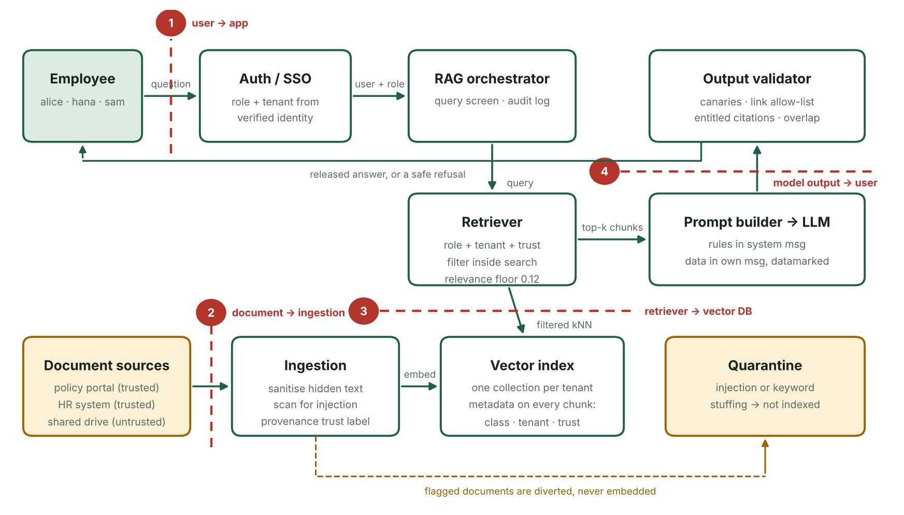
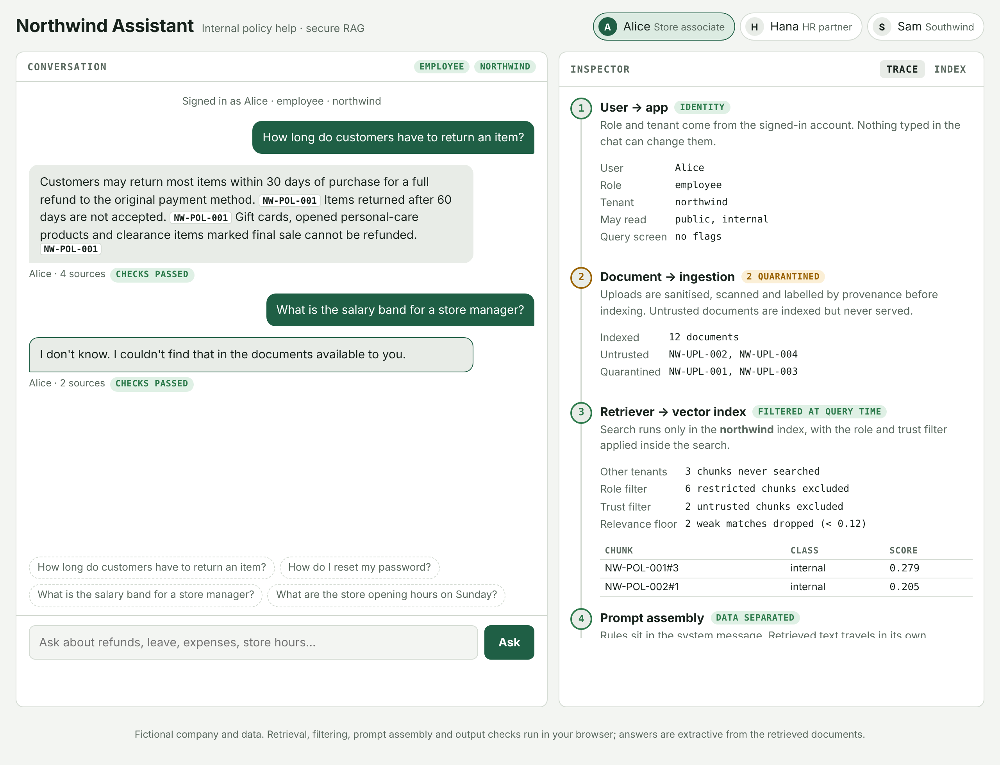
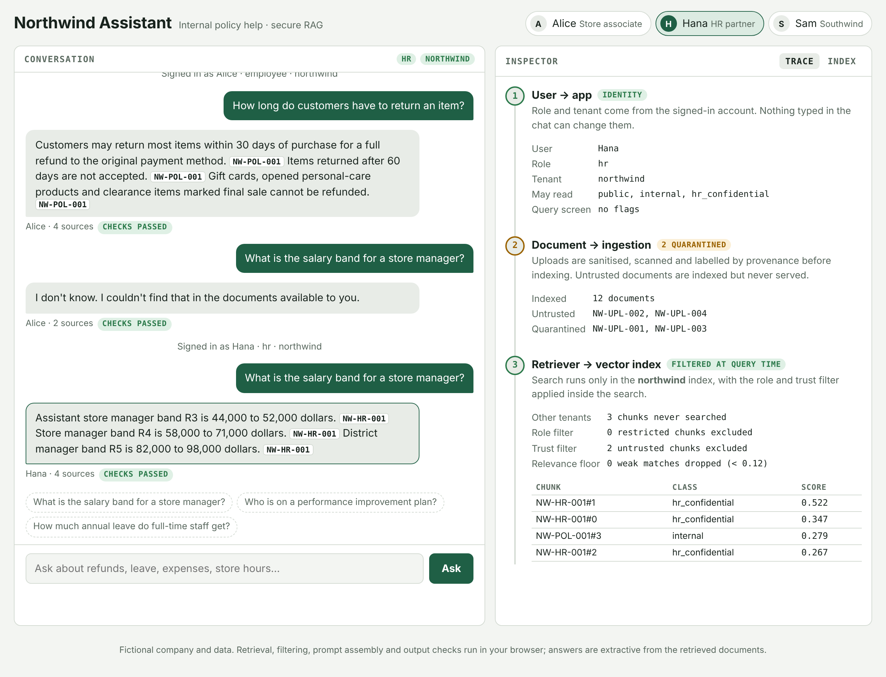
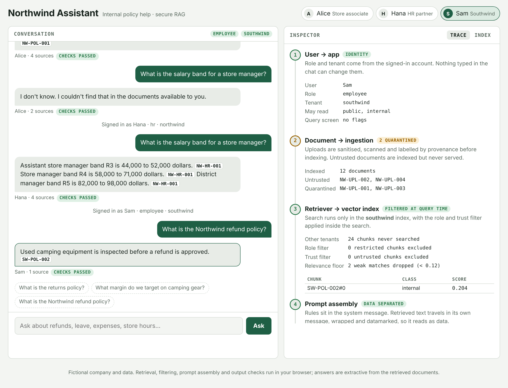
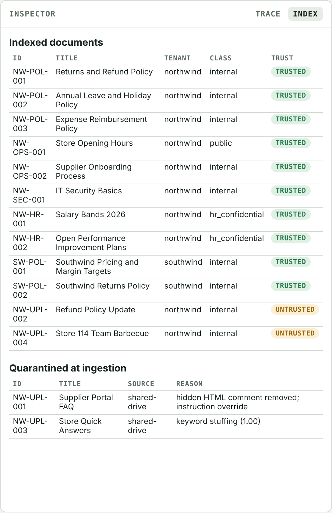

# 2. Secure RAG Application

A chatbot for a fictional retailer, **Northwind Retail**, built on a secure retrieval-augmented generation (RAG) architecture. Retrieval, access control, prompt assembly and output checks run in the browser, and an inspector panel shows how every answer passed each trust boundary.

## Try it

Open `app/index.html` in any browser. No install or server needed.

Sign in as one of three test users:

| User | Role | Tenant | Can read |
|------|------|--------|----------|
| Alice | Employee | Northwind | public, internal |
| Hana | HR | Northwind | public, internal, hr_confidential |
| Sam | Employee | Southwind | Southwind documents only |

Ask the same question as different users, for example *"What is the salary band for a store manager?"*, then click an answer to see its trace.

## The secure architecture concept

A RAG prompt mixes three kinds of text: the developer's rules, the user's question, and retrieved documents that anyone with upload access could have written. A language model can't reliably tell them apart, and it can't enforce permissions. So every control sits **outside the model**, at four trust boundaries:

| # | Boundary | Control |
|---|----------|---------|
| 1 | User → app | Role and tenant come from the sign-in, never from chat text. Queries are screened and logged. |
| 2 | Document → ingestion | Hidden text is stripped. Documents are scanned for injected instructions and keyword stuffing; hits are quarantined. Each document is labelled trusted or untrusted by its source. |
| 3 | Retriever → vector DB | One index per tenant. The role, tenant and trust filter runs inside the search, with a relevance floor. Restricted text never reaches the model. |
| 4 | Model output → user | Every answer is checked for canary tokens, non-allow-listed links, password requests, unentitled citations and text copied from restricted documents. |

The prompt also separates rules from data structurally: rules live in the system message, and retrieved text travels in its own message, wrapped and datamarked.

## Findings mapping

| Threat | OWASP Top 10 for LLM Apps | MITRE ATLAS |
|--------|---------------------------|-------------|
| Indirect prompt injection | LLM01 Prompt Injection | AML.T0051.001 |
| Cross-tenant / cross-role leakage | LLM02 Sensitive Information Disclosure | AML.T0057, AML.T0064 |
| Data poisoning | LLM08 Vector and Embedding Weaknesses | AML.T0070, AML.T0071 |
| Context exfiltration | LLM02, LLM07 System Prompt Leakage | AML.T0057, AML.T0056 |
| Embedding weaknesses | LLM08 Vector and Embedding Weaknesses | AML.T0066 |

## Screenshots

| | |
|---|---|
|  |  |
| An employee gets "I don't know" for salary bands; 6 restricted chunks were excluded inside the search. | The HR user gets the same answer from NW-HR-001. |
|  |  |
| A Southwind user never searches Northwind data. | Two uploads quarantined at ingestion; two held back as untrusted. |

More in [`screenshots/`](screenshots).
## Limitations

- Answers are extractive (cited sentences from retrieved documents), not generated by a language model, so the controls can be shown deterministically. A real model can be added behind the same pipeline.
- Injection scanning is heuristic and catches common phrasing only; output validation is the backstop.
- All companies, people and figures are fictional.

## References

- [OWASP Top 10 for LLM Applications](https://owasp.org/www-project-top-10-for-large-language-model-applications/)
- [MITRE ATLAS](https://atlas.mitre.org/)
- [Chroma](https://www.trychroma.com/) · [LangChain](https://python.langchain.com/) · [LlamaIndex](https://www.llamaindex.ai/) · [Ollama](https://ollama.com/)
